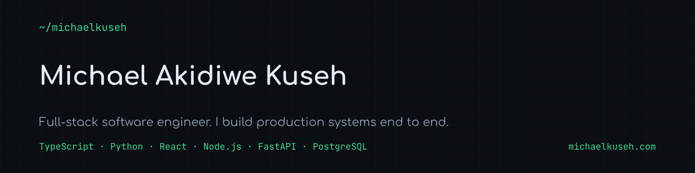

  

  
  
  
  

## About

Full-stack software engineer at **Smart Innovations Ghana** (Accra, UTC+0), building production SaaS products and national government platforms end to end: data models and APIs, React and Next.js frontends, Flutter and React Native field apps, and CI/CD to Linux servers. **Open to remote and contract roles.**

- Lead engineer on **[TerraPulse](https://terrapulze.com)**, a geospatial SaaS that turns mineral-exploration data into ranked drill targets (FastAPI, PostGIS, Celery, Next.js; about 590 automated tests).
- Tech lead in a six-person team on **[Evenofy](https://evenofy.com)**, a multi-tenant event platform (Next.js, Express, Prisma, PostgreSQL).
- Lead and core developer on five national regulatory platforms, including the company's first Ghana.GOV e-payment integration.
- Backend and web lead (contract) for **Coasted**, a gamified maths app with live multiplayer and Paystack, App Store and RevenueCat payments.
- Built **[BoldGym](https://boldfitnessgh.com)**, the system a real gym runs on every day.

## Open source

| Project | What it is |
|---|---|
| [**Keystone**](https://github.com/AkideweKuseh/Keystone) | Access-control middleware that drives Hikvision door terminals over ISAPI. NestJS, BullMQ, PostgreSQL, React. 67 tests, CodeQL and gitleaks in CI. |
| [**OpenBanner**](https://github.com/AkideweKuseh/openbanner) | Self-hosted image generation API for automations (n8n). Express 5, Puppeteer, MinIO, hardened Docker deploy. In use at Smart Innovations Ghana. |

Case studies with architecture diagrams: **[michaelkuseh.com](https://michaelkuseh.com)**

## Stack

**Languages**
 

**Frontend and mobile**
 

**Backend**
 

**Data**
 

**AI and payments**
 

**DevOps and testing**
 

## GitHub activity

  
  

## Elsewhere

[Medium](https://medium.com/@michaelakidewe) · [dev.to](https://dev.to/michael_kuseh) · [Stack Overflow](https://stackoverflow.com/users/15395289) · [X](https://twitter.com/mikke_blaze) · [LeetCode](https://leetcode.com/blazekuseh)
